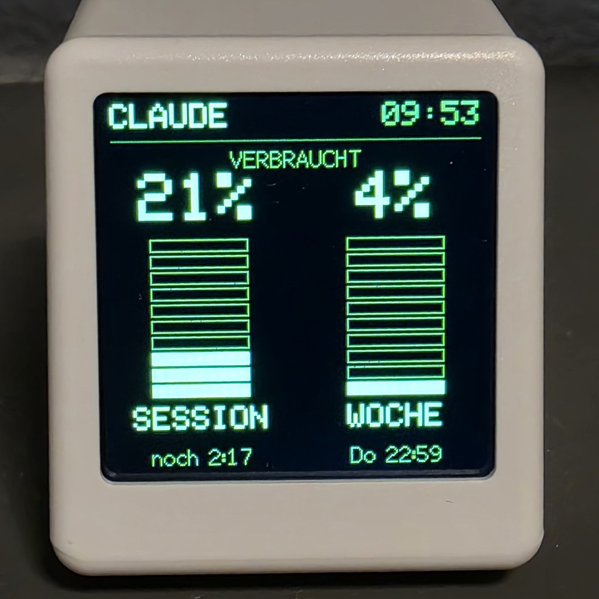
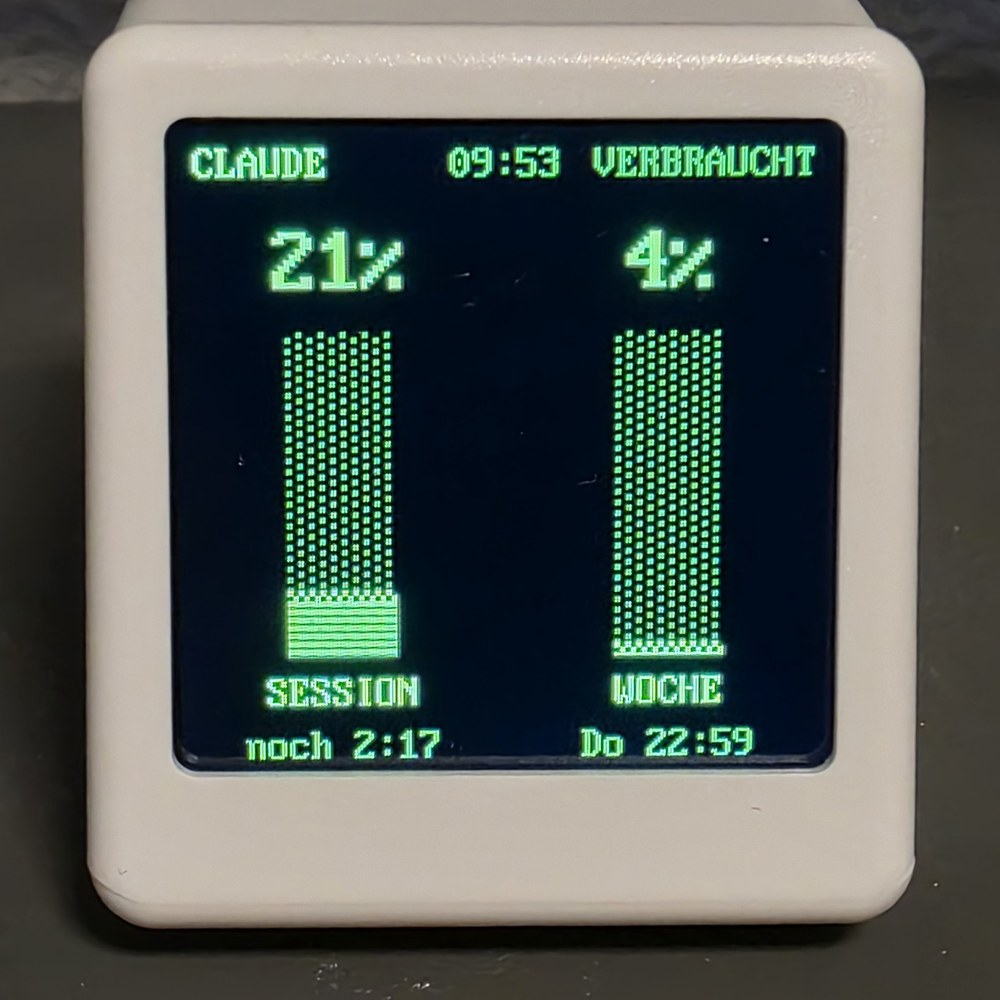
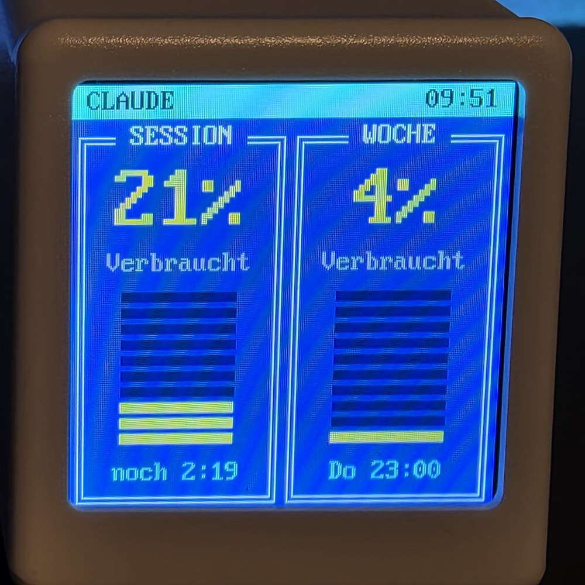
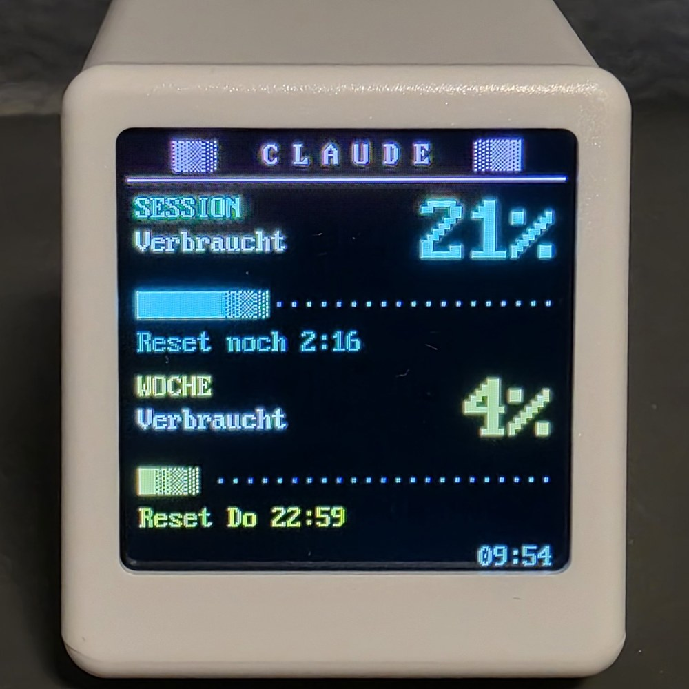
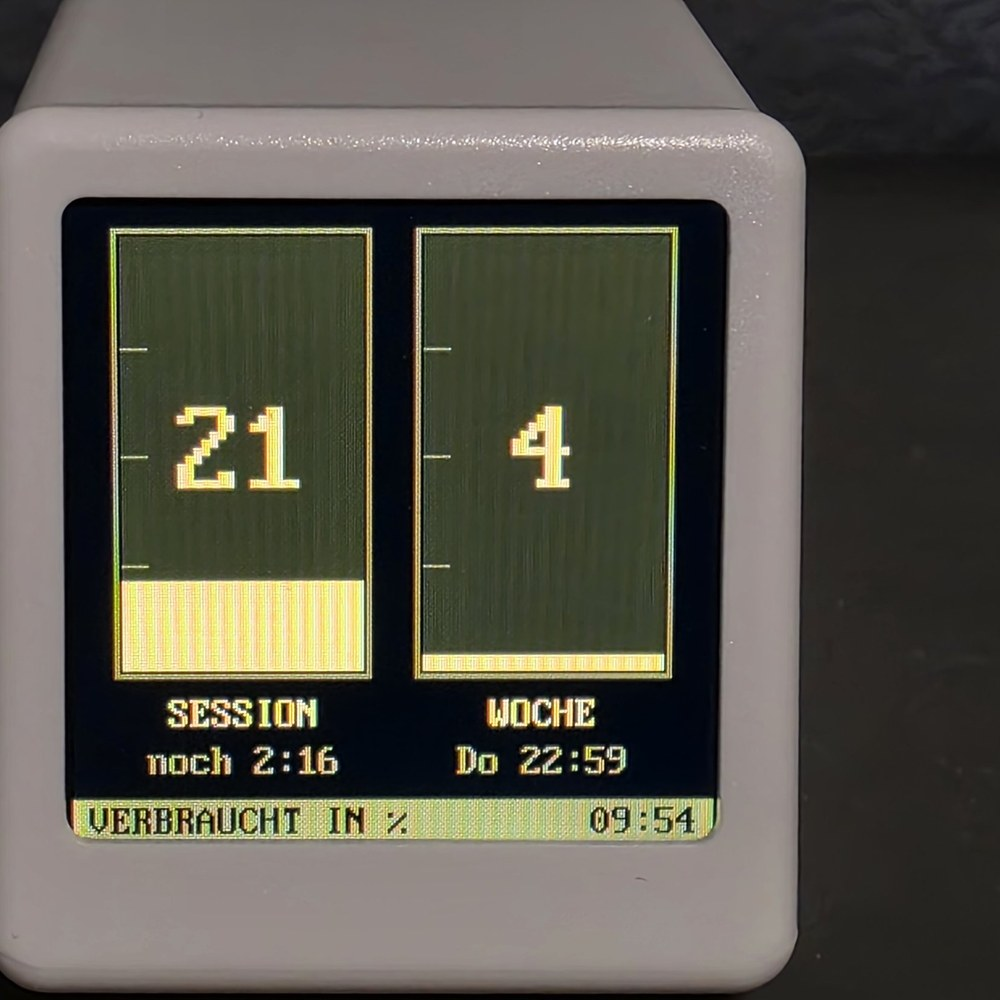

# SysopTV

SysopTV is a free firmware for the GeekMagic SmallTV Ultra. It shows your Claude usage limits on your desk: the 5 hour session and the weekly limit, each with its reset time.

<table>
  <tr>
    <td align="center"><br>Säulen</td>
    <td align="center"><br>Phosphor</td>
    <td align="center"><br>DOS</td>
  </tr>
  <tr>
    <td align="center"><br>ANSI</td>
    <td align="center"><br>Bernstein</td>
    <td></td>
  </tr>
</table>

There are six designs: Säulen, Phosphor, DOS, ANSI, Bernstein and Klassik. Klassik follows the layout of the image that an older PC script made for the original firmware: the session big in the middle, the week as a bar of 16 segments below. A photo of Klassik follows later.

The name comes from the sysop, who in the days of dial-up mailboxes kept an eye on all systems from a single screen.

## Please read first

- This is an unofficial project. It is not affiliated with Anthropic or GeekMagic.
- The limits come from an undocumented endpoint that Claude Code uses as well. It can change or disappear at any time.
- Flashing is at your own risk. The device has no USB data connection. If something goes wrong and the update page can no longer be reached, the only way back is a USB serial adapter and some soldering.

## Status

Version 0.3.1.

Tested on real hardware:

- flashing through the web interface of the original firmware
- WLAN setup through the setup hotspot
- the designs Säulen, Phosphor, DOS, ANSI and Bernstein with live data
- clock
- updates through the `/update` page

Not yet tested on real hardware, so there is no promise that these work:

- the design Klassik
- admin password and the protection of the pages
- saving the settings
- brightness and night mode
- emergency reset of the password
- API key
- display without the PC (NO CARRIER)
- `/flashbackup`
- going back to the original firmware

## How it works

The cube cannot fetch the limits by itself. A small PowerShell script on your Windows PC, the sender, reads the login key of Claude Code locally, asks for the limits and sends only the percentages and reset times to the cube over your local network. The key never leaves the PC and is never sent to the cube.

The repository contains exactly this sender in `sender/`. There is no script for the original firmware.

Without the sender the cube shows the "Ready" screen with its IP address after a start. If data has arrived once and then nothing comes for 10 minutes, it shows the clock and "NO CARRIER".

## Requirements

- GeekMagic SmallTV Ultra with ESP8266. Other models, for example the Pro or variants with ESP32, are not supported. Do not flash SysopTV onto them.
- A Windows PC with Windows PowerShell 5.1 in the same network.
- Claude Code installed and logged in with a Claude subscription. The file `.credentials.json` must exist in the folder `.claude` of your user profile.

## Installing the firmware

1. Download `sysoptv-<version>.bin` from the GitHub Releases, or build it yourself (see "Building").
2. Open the web interface of the original GeekMagic firmware in your browser, using the IP address of the cube. At the bottom, under "Firmware update", select the .bin file and upload it.
3. After the restart SysopTV tries a saved WLAN for 20 seconds. The WLAN of the original firmware is not taken over, so on the first start it opens an open hotspot named `SysopTV-Setup`.
4. Connect your phone or laptop to `SysopTV-Setup` and open `http://192.168.4.1` in the browser. Pick your network (2.4 GHz only), enter the password and save. The cube restarts and shows its IP address on the display.
5. From then on SysopTV is reachable at that IP address or at `http://sysoptv.local`.
6. Give the cube a fixed IP address in your router. The sender needs the address, and it should not change.
7. First thing: set the admin password on the overview page. It needs at least 8 characters (at most 64). When the browser asks for the login, the user name does not matter.

If nobody connects to the hotspot for three minutes and a WLAN is saved, SysopTV restarts and tries the saved WLAN again, in case the router was just off for a moment.

## Setting up the sender

The sender is the file `sender/sysoptv-sender.ps1`. It needs nothing besides Windows PowerShell 5.1, which is part of Windows.

### 1. Copy it

Copy the folder `sender` to your PC, for example to `C:\Path\to\sender\`. The location is up to you.

### 2. Test it once

Run the test in PowerShell, not in the classic command prompt (cmd). If you have cmd open, type `powershell` first. The line then starts with `PS`.

Go to the folder and start a single run. Use the IP address of your cube instead of `192.168.178.50`:

```powershell
cd C:\Path\to\sender
powershell -ExecutionPolicy Bypass -File .\sysoptv-sender.ps1 -DeviceIp 192.168.178.50 -Once
```

The window shows what was read and sent, and whether the cube accepted it. A few seconds later the cube shows the limits.

If the window says that the sender is already running, another sender is active on this PC. Two senders would ask for the limits twice, so the second one stops.

### 3. Parameters

| Parameter | Default | Meaning |
|---|---|---|
| `-DeviceIp` | `sysoptv.local` | Address of the cube. An IP address is more reliable than the name. |
| `-IntervalSeconds` | `120` | Seconds between two queries. |
| `-ApiKey` | empty | Only needed if an API key is set in the cube, see below. |
| `-Once` | off | One single run with output in the window, for testing. |

> **Do not go below 120 seconds.** Querying every 60 seconds made the server answer with error 429 (too many requests) all the time. The script raises smaller values to 120 by itself. After a 429 it waits at least 5 minutes, or longer if the server asks for it.

### 4. Start it automatically

1. Press Win+R, type `shell:startup` and press Enter. The startup folder opens.
2. Right-click in the folder, choose "New", then "Shortcut".
3. Enter this as the target, with your own path and IP address:

   ```
   C:\Windows\System32\WindowsPowerShell\v1.0\powershell.exe -WindowStyle Hidden -ExecutionPolicy Bypass -File "C:\Path\to\sender\sysoptv-sender.ps1" -DeviceIp 192.168.178.50
   ```

4. Name it, for example "SysopTV Sender". From the next login on the sender runs in the background without a window.

The sender writes a log to `%LOCALAPPDATA%\SysopTV\sender.log`. It only notes changes, errors and when the cube becomes reachable or unreachable. At 200 KB the log is renamed to `sender.log.old` and a new one is started.

### Login expired

The login key of Claude Code runs out after a few hours. It is only renewed when you use Claude Code. If the cube shows "ANMELDUNG ABGELAUFEN" (login expired), simply use Claude Code for a moment. The sender never renews the key by itself, on purpose: renewing it changes the stored login of Claude Code, and a mistake there could log you out.

### When something fails

A single failed query does not change the display. The sender keeps sending the last valid values with the current time, so the cube knows that the PC is still running. It only reports an error after 3 failed queries in a row, or when the last valid values are older than 15 minutes. The cube then shows "NO CARRIER". Rounds in which the sender waits because of a 429 do not count as failed queries, only the age of the values counts then.

### Optional API key

Without an API key, anyone in your network can send values to the cube. With a key, only a sender that knows the key may do that.

1. Open "Einstellungen" (settings) in the web interface and press "Neuen Schlüssel erzeugen" (create new key).
2. Add the key shown there to the sender: `-ApiKey <key>`. Do this in the test command and in the startup shortcut as well.

If the key is missing or wrong, the cube answers with error 401 and the log of the sender says so.

## Using the web interface

The pages are in German. At the top there are three links: Übersicht (overview), Einstellungen (settings) and Update.

**Übersicht** (overview, `/`) shows:

- session and week with percentage, a bar and the reset time as on the display
- when the last data from the PC arrived, or a hint if no data comes, the login has expired or the sender cannot reach Anthropic
- the active design and whether the automatic change is on
- the device: WLAN, IP address, mDNS name, signal, whether the clock is set, uptime, free memory, reason of the last restart
- the link to the flash backup

The values refresh every 10 seconds. Without a password the page also offers the form to set the admin password.

**Einstellungen** (settings, `/settings`):

- design: Säulen, Phosphor, DOS, ANSI, Bernstein or Klassik
- automatic change: off, every 30 or every 60 seconds
- show percentages as used ("verbraucht", the default, like on claude.ai) or left ("übrig"). The warning colour always appears when less than 20 % are left.
- brightness 10 to 100 %
- night mode with a start and end time and its own brightness from 0 to 100 % (0 switches the display off). It needs the time, from the PC or from the internet (NTP).
- create, show or delete the API key
- change the admin password

The settings are stored permanently in the cube and are only written when something changes.

**Update** (`/update`) installs a new firmware file. Going back to the original firmware has not been tested yet, so download the flash backup from the overview first. If an update fails, the current firmware stays intact and SysopTV restarts after a few seconds. Do not cut the power during an update.

**Flash backup** (`/flashbackup`, link on the overview) downloads a copy of the flash area 0x100000 to 0x3FA000. That is where the original firmware keeps its files, including its own web interface. It is only available once an admin password is set, because it may contain login data of the original firmware. Keep it to yourself.

The clock comes from the PC. When no data from the PC has arrived for 15 minutes, SysopTV uses internet time (NTP, pool.ntp.org) with the time zone of Germany (Europe/Berlin, including daylight saving time).

## Emergencies

### Forgotten password

Unplug the cube three times in a row, each time within 10 seconds after plugging it in. On the fourth start the password, the API key and all settings are reset. The WLAN stays. The display shows "Passwort zurückgesetzt" (password reset) for a moment. Only starts after plugging in count, crashes and restarts do not.

This has not been tested on real hardware yet.

### Rescue mode

If the firmware crashes three times in a row, SysopTV starts in rescue mode. It ignores the settings and only offers WLAN, the overview and the update page, so you can install a working version. The update page keeps the admin password, if it can still be read.

### Back to the original firmware

This has not been tested yet, so there are no instructions here for now.

## Building

You need arduino-cli, the esp8266 core 3.1.2, TFT_eSPI 2.5.43 and ArduinoJson 7.4.3:

```sh
arduino-cli core install esp8266:esp8266@3.1.2 \
  --additional-urls https://arduino.esp8266.com/stable/package_esp8266com_index.json
arduino-cli lib install "TFT_eSPI@2.5.43"
arduino-cli lib install "ArduinoJson@7.4.3"
```

Then run the build script in Git Bash (on Windows), WSL or Linux:

```sh
bash build.sh
```

The script checks that exactly these library versions are installed. The firmware ends up in `dist/sysoptv-<version>.bin`. The display settings are passed as compiler flags, so there is no need to edit `User_Setup.h` in TFT_eSPI.

`build.sh` stops if the image is larger than 500000 bytes. An update is first written next to the running firmware, and both have to fit into 1 MB. The original GeekMagic firmware is about 505 KB, so SysopTV has to stay small enough for it to fit next to it. Otherwise there would be no way back over WLAN.

The flash layout is 4M3M, the same as the original firmware: program and update buffer below 0x100000, the area of the original firmware from 0x100000 to 0x3FA000 is never written. SysopTV stores its settings in the 4 KB EEPROM sector at 0x3FB000.

Hardware for contributors: ESP8266 (ESP-12F), 4 MB flash, 26 MHz crystal, ST7789 display with 240x240 pixels without CS line in SPI mode 3. Pins: MOSI 13, SCLK 14, DC 0, RST 2, backlight 5 (active low).

## Plans

Later the cube should be able to show other data as well, for example orders from an online shop.

## License and thanks

The firmware and the sender are licensed under the GNU General Public License v3.0, see [LICENSE](LICENSE).

The embedded font in `firmware/SysopTV/font_vga.h` is **not** under the GPL. It is converted from "Px437 IBM VGA 8x16" of [The Ultimate Oldschool PC Font Pack](https://int10h.org/oldschool-pc-fonts/) by VileR and licensed under [CC BY-SA 4.0](https://creativecommons.org/licenses/by-sa/4.0/).

Thanks to:

- the [ESP8266 Arduino core](https://github.com/esp8266/Arduino)
- [TFT_eSPI](https://github.com/Bodmer/TFT_eSPI) by Bodmer
- [ArduinoJson](https://github.com/bblanchon/ArduinoJson) by Benoît Blanchon
- the [ESPHome device documentation for the SmallTV Ultra](https://devices.esphome.io/devices/geekmagic-ultra/), for the pin assignment
- the [GeekMagic firmware repository](https://github.com/GeekMagicClock/smalltv-ultra), for the original firmware
- [CodexBar](https://github.com/steipete/CodexBar), the model for how the usage limits are queried

Claude is a trademark of Anthropic. GeekMagic is a trademark of GeekMagic.

## Auf Deutsch

SysopTV ist eine freie Firmware für den GeekMagic SmallTV Ultra mit ESP8266. Sie zeigt am Schreibtisch die Claude-Nutzungslimits an, die 5-Stunden-Session und die Woche, jeweils mit Reset-Zeit. Es ist ein inoffizielles Projekt ohne Verbindung zu Anthropic oder GeekMagic. Die Limits kommen über einen nicht dokumentierten Endpunkt, der sich jederzeit ändern kann.

Aufgespielt wird über „Firmware update“ unten in der Weboberfläche der Original-Firmware. Danach richtet man das WLAN über den Hotspot `SysopTV-Setup` und `192.168.4.1` ein und legt als Erstes das Admin-Passwort fest. Die Werte schickt das Sende-Skript im Ordner `sender/` vom Windows-PC, der Anmeldeschlüssel von Claude Code verlässt dabei nie den PC. Das Gerät hat keinen USB-Datenanschluss: Geht beim Flashen etwas schief und die Update-Seite ist nicht mehr erreichbar, hilft nur ein USB-Seriell-Adapter mit Lötarbeit. Die Benutzung ist auf eigenes Risiko.
