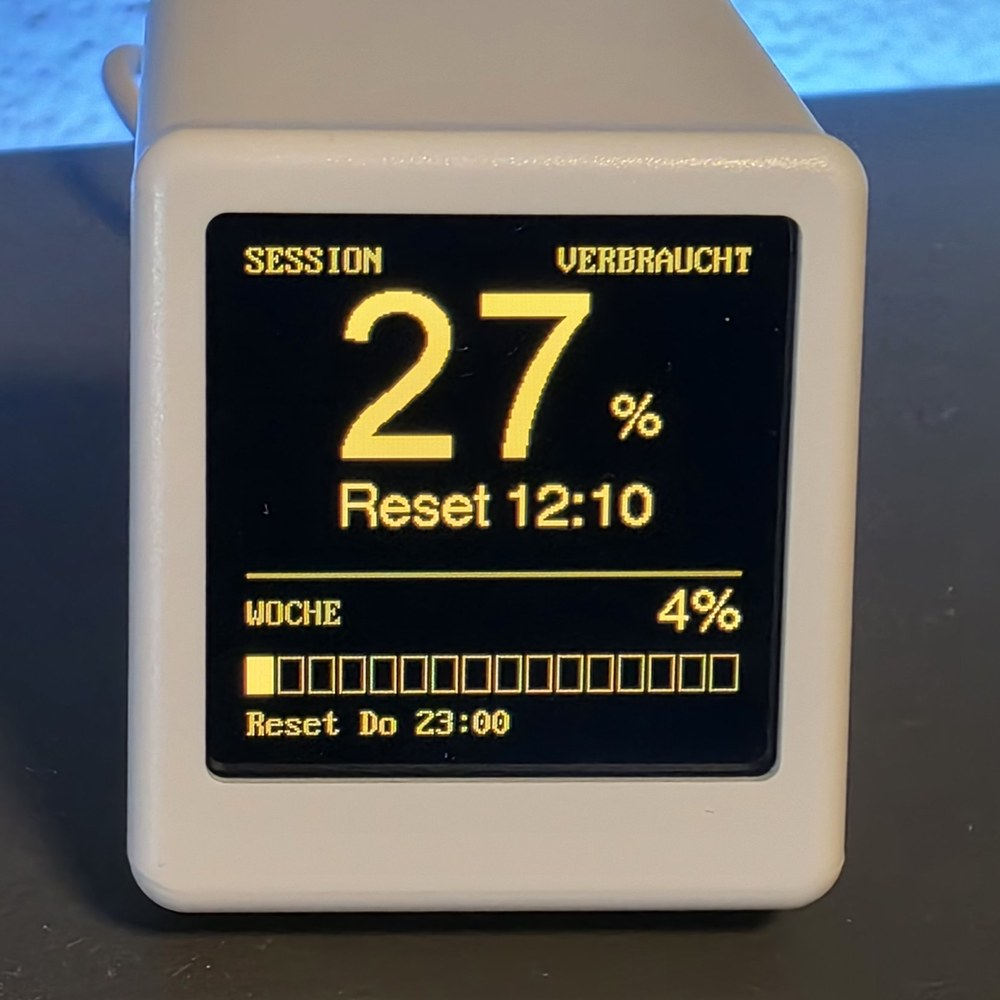

# SysopTV

A free firmware and Windows program for the GeekMagic SmallTV Ultra that shows your Claude usage limits and the orders of your Shopify or WooCommerce shop on your desk.

  
  
  
  
  

<a href="docs/designs.md">All designs</a>

The name comes from the sysop, who in the days of dial-up mailboxes kept an eye on all systems from a single screen.

## Quick start

1. Get a GeekMagic SmallTV Ultra with ESP8266 and a Windows 10 or 11 PC in the same network.
2. Put the firmware on the cube through the web interface of the original firmware and connect it to your WLAN: [Installation](docs/installation.md).
3. Install the Windows program, find the cube and choose the function Claude Limits, Shopify or WooCommerce: [Windows app](docs/windows-app.md).
4. For the Claude display, Claude Code must be installed and logged in: [Claude limits](docs/claude.md).
5. For a shop, connect it: [Shopify](docs/shopify-setup.md) or [WooCommerce](docs/woocommerce-setup.md).

## Documentation

All guides are listed in [docs/README.md](docs/README.md), including the status of what has been tested on real hardware. The most important ones:

- [Installation](docs/installation.md)
- [Windows app](docs/windows-app.md)
- [Shopify](docs/shopify-setup.md) and [WooCommerce](docs/woocommerce-setup.md)
- [Designs](docs/designs.md)
- [Troubleshooting](docs/troubleshooting.md)
- [Privacy and security](docs/privacy-security.md)
- [Developers](docs/developers.md)

Auf Deutsch: [Schnellstart](docs/de/schnellstart.md).

Project website: [sysoptv.de](https://sysoptv.de).

## Downloads

Firmware, Windows program and WordPress plugin are on the [GitHub Releases](https://github.com/alph4r79/SysopTV/releases) page.

## Please note

- This is an unofficial project. It is not affiliated with Anthropic, Shopify, WooCommerce or GeekMagic.
- The Claude limits come from an undocumented endpoint that Claude Code uses as well. It can change or disappear at any time.
- Flashing is at your own risk. The cube has no USB data connection. If something goes wrong and the update page can no longer be reached, the only way back is a USB serial adapter and some soldering.

## License and thanks

The firmware, the Windows program and the PowerShell script are licensed under the GNU General Public License v3.0, see [LICENSE](LICENSE). The WordPress plugin is licensed under GPL-3.0-or-later.

The embedded font in `firmware/SysopTV/font_vga.h` is **not** under the GPL. It is converted from "Px437 IBM VGA 8x16" of [The Ultimate Oldschool PC Font Pack](https://int10h.org/oldschool-pc-fonts/) by VileR and licensed under [CC BY-SA 4.0](https://creativecommons.org/licenses/by-sa/4.0/). The same applies to `app/SysopTV.Tray/VgaFont.cs`, which adds the euro sign from "PxPlus IBM VGA 8x16" of the same font pack.

The styles Hell and Fallblatt use two fonts under the [SIL Open Font License 1.1](https://openfontlicense.org/). They are embedded in the program, nothing is installed in Windows, and the license texts are in `app/assets/fonts/` and next to the program:

- [Inter](https://github.com/rsms/inter) 4.1 (Regular and Bold), Copyright (c) 2016 The Inter Project Authors, from the official release on GitHub. License: `OFL-Inter.txt`.
- [JetBrains Mono](https://github.com/JetBrains/JetBrainsMono) 2.304 (Bold), Copyright 2020 The JetBrains Mono Project Authors, from the official release on GitHub. License: `OFL-JetBrainsMono.txt`.

`app/SysopTV.Tray/TftFonts.cs` contains the fonts of TFT_eSPI 2.5.43 as plain bitmaps, so the pictures of the program look like the display: the GLCD font of Adafruit_GFX (Copyright (c) 2012 Adafruit Industries, BSD license) and Font 2, 4 and 8 of TFT_eSPI (Copyright (c) 2023 Bodmer, FreeBSD license). The license texts are in the head of the file.

Thanks to:

- the [ESP8266 Arduino core](https://github.com/esp8266/Arduino)
- [TFT_eSPI](https://github.com/Bodmer/TFT_eSPI) by Bodmer
- [ArduinoJson](https://github.com/bblanchon/ArduinoJson) by Benoît Blanchon
- the [ESPHome device documentation for the SmallTV Ultra](https://devices.esphome.io/devices/geekmagic-ultra/), for the pin assignment
- the [GeekMagic firmware repository](https://github.com/GeekMagicClock/smalltv-ultra), for the original firmware
- [CodexBar](https://github.com/steipete/CodexBar), the model for how the usage limits are queried

Claude is a trademark of Anthropic. GeekMagic is a trademark of GeekMagic.
