# Designs

This page shows every picture a cube can show, and the setting on the page "Würfel" of the program that belongs to it.

The pictures come straight from the software (`SysopTV.exe --docs`, sample data). On the real panel the colours look somewhat warmer. The panel shows very dark colours much too bright and with a green tint, so all designs use pure black for dark backgrounds, black text on light backgrounds and keep at least 8 pixels from the edge.

## Claude Limits

Setting: function **Claude Limits**, then **Design**. "Prozent zeigen" switches between used ("verbraucht") and remaining ("übrig"), "Automatisch wechseln" changes through all ten designs.

The first six are also the designs of the firmware. The program draws them with the same colours, fonts and positions, and a cube with older firmware draws them itself. Only the program has the last four.

<table>
  <tr>
    <td align="center">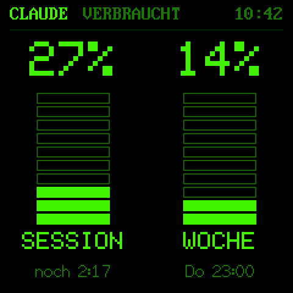 Säulen</td>
    <td align="center">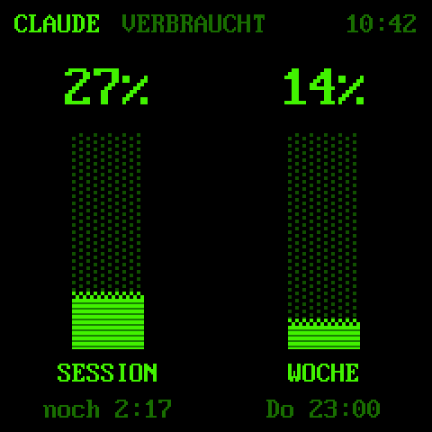 Phosphor</td>
    <td align="center">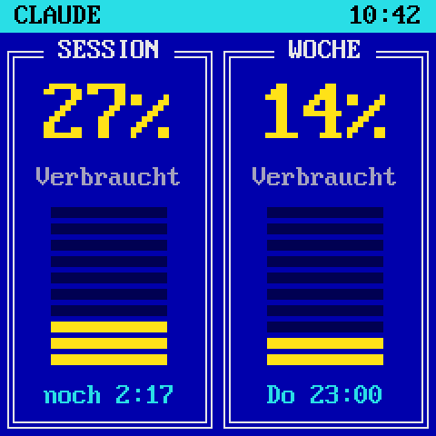 DOS</td>
    <td align="center">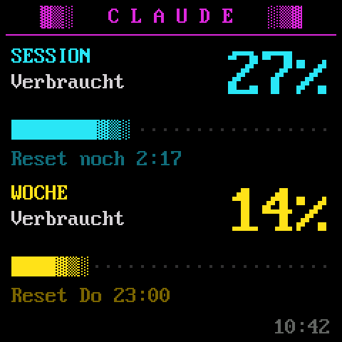 ANSI</td>
  </tr>
  <tr>
    <td align="center">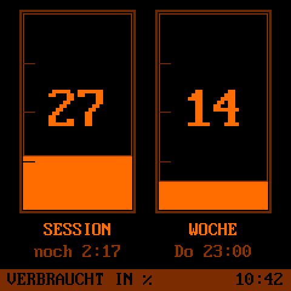 Bernstein</td>
    <td align="center">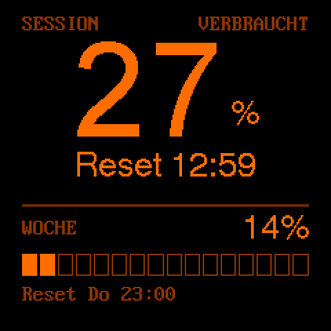 Klassik</td>
    <td align="center">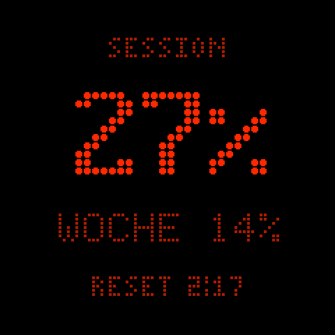 LED-Matrix</td>
    <td align="center">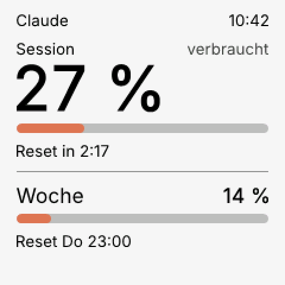 Hell</td>
  </tr>
  <tr>
    <td align="center">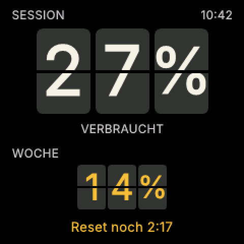 Fallblatt</td>
    <td align="center">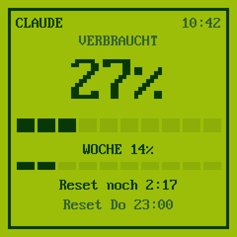 4-Ton-Grün</td>
    <td align="center">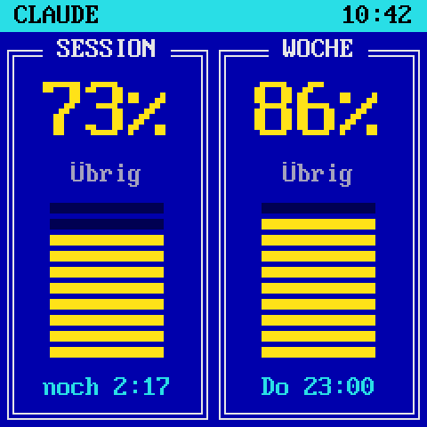 DOS, übrig</td>
    <td align="center">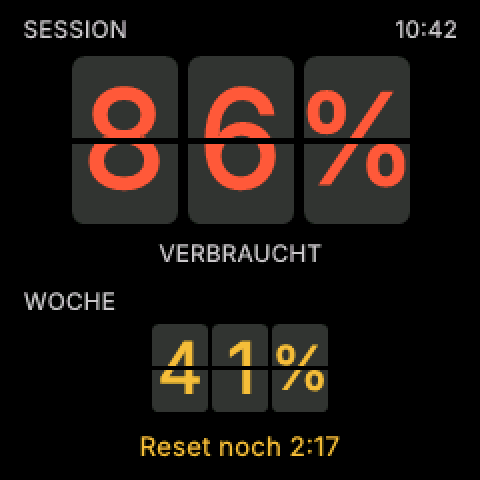 Fallblatt, warning colour</td>
  </tr>
</table>

- **Säulen** (columns): two tanks of 10 segments in green, empty segments as outline.
- **Phosphor**: green text mode with narrow columns.
- **DOS**: blue background, a cyan menu bar, two windows with double frames and a big number in yellow.
- **ANSI**: a logo line in magenta, session in cyan, week in yellow, bars with a fading shade.
- **Bernstein** (amber): two tanks with a scale at 25, 50 and 75 %, the number inside the tank.
- **Klassik** (classic): the session very big in the middle, the week as a bar of 16 segments. With 5 % or less left a red frame appears.
- **LED-Matrix**: only lit round dots on pure black, like a display board. Below 20 % left the main value turns yellow.
- **Hell** (light): a calm light layout with the font Inter, session and week each with a bar and the reset.
- **Fallblatt** (split flap): every character on its own card. When a character changes, its card flips over in three small steps; switch it off with "Klapp-Animation".
- **4-Ton-Grün** (four tone green): only four shades of green, block bars and a frame. Below 20 % left the value blinks instead of changing its colour.

All designs show "nicht aktiv" when no session is running, "ANMELDUNG ABGELAUFEN" when the login of Claude Code has expired, and a small "Stand HH:MM" when the values are not fresh, see [Claude limits](claude.md).

## Shop big display

Setting: function **Shopify** or **WooCommerce**, **Ansicht** "Großanzeige", then **Zeitraum**, **Inhalt** and **Stil**.

Eleven styles. The first seven show one period with one big number: here today with orders and revenue, and the period "Dieses Jahr" (this year) in Fallblatt.

<table>
  <tr>
    <td align="center">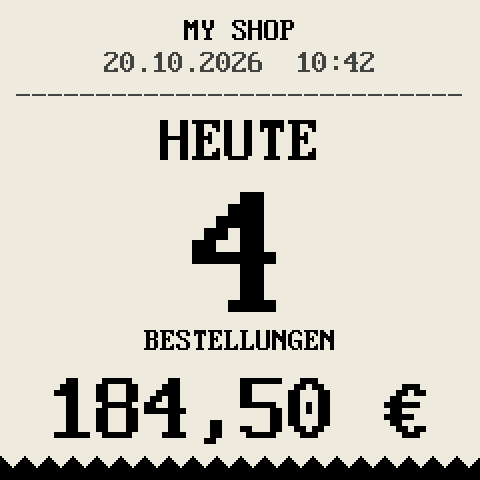 Kassenbon</td>
    <td align="center">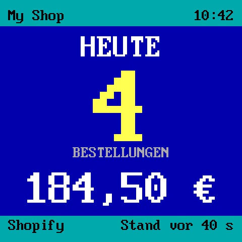 DOS</td>
    <td align="center">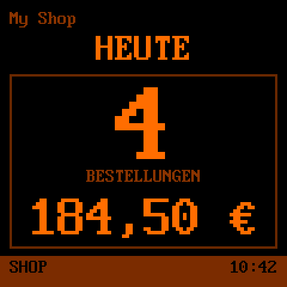 Bernstein</td>
    <td align="center">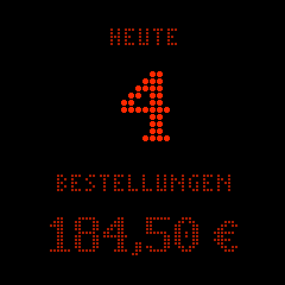 LED-Matrix</td>
  </tr>
  <tr>
    <td align="center">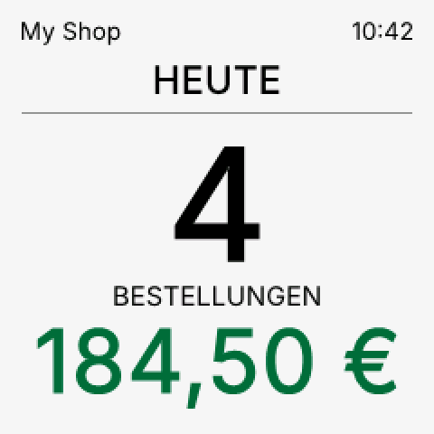 Hell</td>
    <td align="center">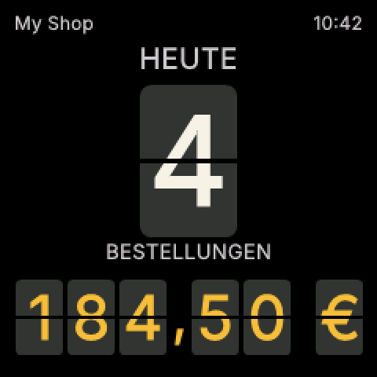 Fallblatt</td>
    <td align="center">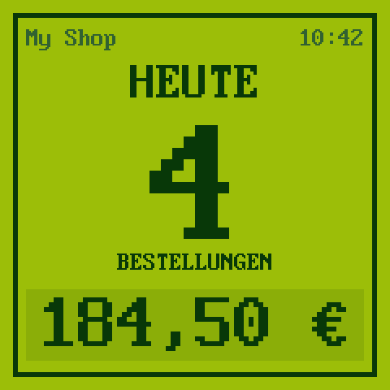 4-Ton-Grün</td>
    <td align="center">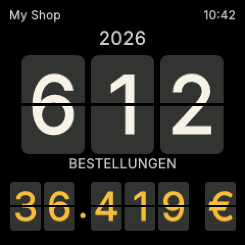 Fallblatt, this year</td>
  </tr>
</table>

The four styles Klassik, Säulen, Phosphor and ANSI look like the Claude designs of the same name, without bars, and always show several periods together: Klassik today, this week and this month, the other three today and this week. They do not follow "Zeitraum" and "Inhalt"; while one of them is chosen, the program greys out these two settings and says "Dieser Stil zeigt Heute, Woche und Monat zusammen." (Klassik) or "Dieser Stil zeigt Heute und Woche zusammen." The settings stay stored and count again as soon as you choose another style.

<table>
  <tr>
    <td align="center">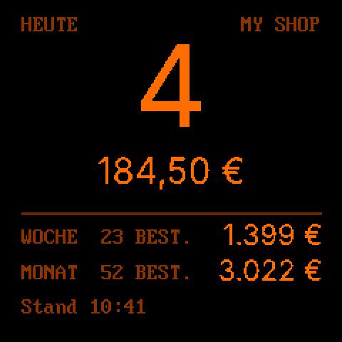 Klassik</td>
    <td align="center">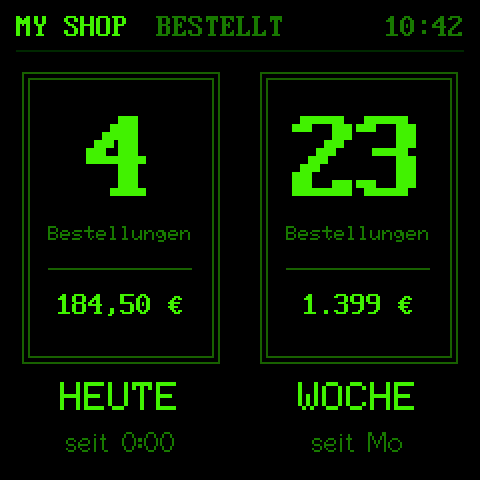 Säulen</td>
    <td align="center">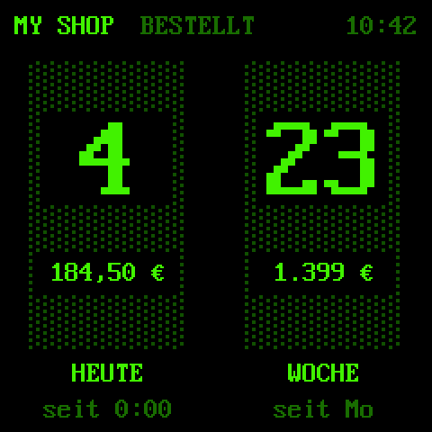 Phosphor</td>
    <td align="center">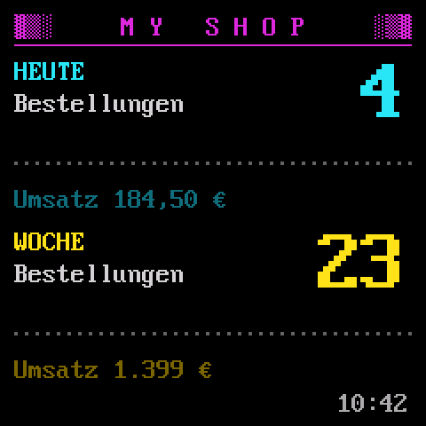 ANSI</td>
  </tr>
</table>

- **Zeitraum** (period): today, this week (since Monday 0:00), this month (since the 1st) or this year (since 1 January), in the time zone of the shop. The heading says HEUTE, DIESE WOCHE, the name of the month or the year.
- **Inhalt** (content): only orders, only revenue, or both. With both, the count comes first, below it BESTELLUNGEN (orders), then the revenue.
- **Stil** (style): Kassenbon (receipt), DOS, Bernstein, LED-Matrix, Hell, Fallblatt, 4-Ton-Grün, Klassik, Säulen, Phosphor or ANSI.
- **Klassik** (classic): today's orders very big in amber, below them today's revenue, then one line each for the week and the month with orders and revenue, and the time the numbers were read ("Stand").
- **Säulen** (columns): two green columns with a double frame for today and the week, each with the number of orders, the revenue and below it "seit 0:00" (since 0:00) or "seit Mo" (since Monday).
- **Phosphor**: two dotted green columns for today and the week, the number of orders and the revenue in black fields.
- **ANSI**: a logo line in magenta with the shop name, today in cyan and the week in yellow, each with the number of orders and the revenue.

Amounts from 1000 on have no cents and a dot (3.022 €), below that a comma (184,50 €). A number that does not fit gets a smaller size, it is never cut, also four digit order counts and six digit amounts like 123.456 €. If the year is missing (Shopify without `read_all_orders`, or a WooCommerce plugin older than 0.2.0), the year shows a notice instead.

## Shop details

Setting: function **Shopify** or **WooCommerce**, **Ansicht** "Details", then **Design**. "Automatisch wechseln" changes through the four.

<table>
  <tr>
    <td align="center">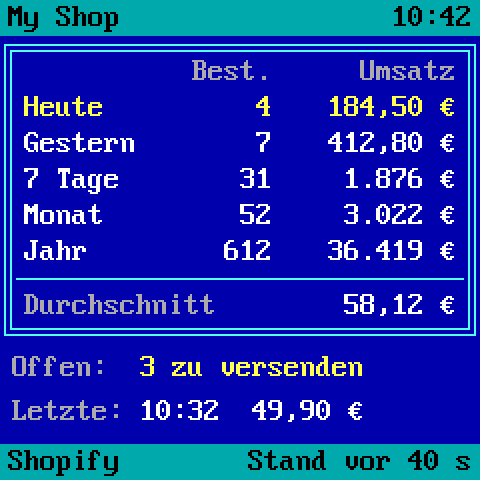 Tabelle</td>
    <td align="center">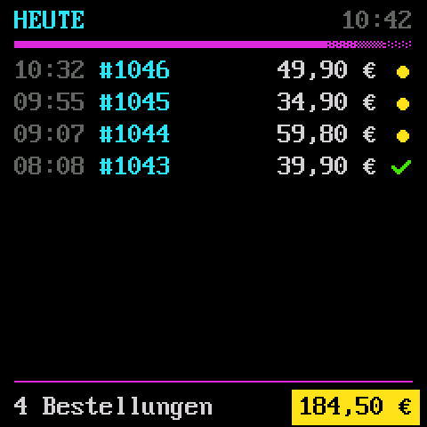 Bestellliste</td>
    <td align="center">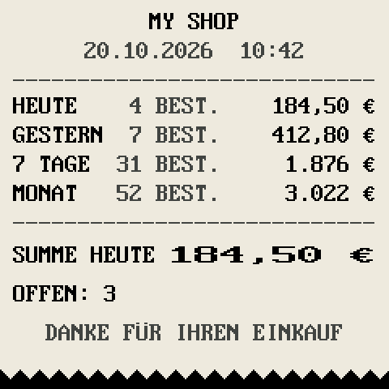 Kassenbon Übersicht</td>
    <td align="center">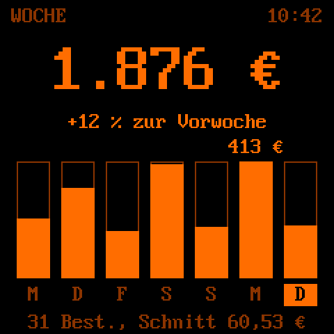 Wochendiagramm</td>
  </tr>
</table>

- **Tabelle** (table): today, yesterday, 7 days, the month and the year with orders and revenue, the average, open orders and the last order.
- **Bestellliste** (order list): today's orders, newest first, with time, order number, amount and a green tick for shipped or a yellow dot for open. Without orders it shows "Noch keine Bestellung heute" and when the last one came.
- **Kassenbon Übersicht** (receipt overview): a receipt on light paper with today, yesterday, 7 days and month, the sum of today in double width and the open orders.
- **Wochendiagramm** (week chart): the revenue of the last 7 days, the change to the week before, one bar per day with today on the right, and the number of orders with the average.

## Notices

As long as there are no values at all, the cube shows a short notice in the colours of the chosen design instead, for example "Claude-Daten werden geladen" (loading Claude data), "Shopdaten werden geladen" (loading shop data), "Zu viele Anfragen" (too many requests) or "Shop nicht erreichbar" (shop not reachable) with the time of the next try, "Schlüssel ungültig" (key invalid), "Zugang prüfen" (check the access) or "Shop nicht eingetragen" (shop not set up).
