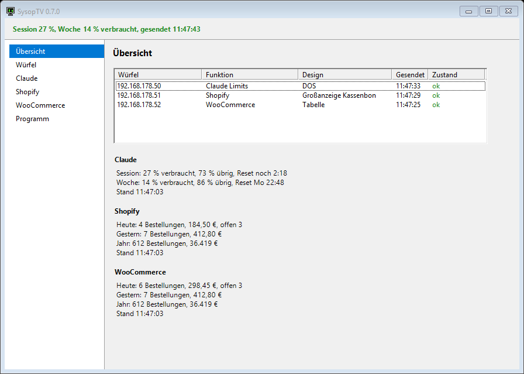
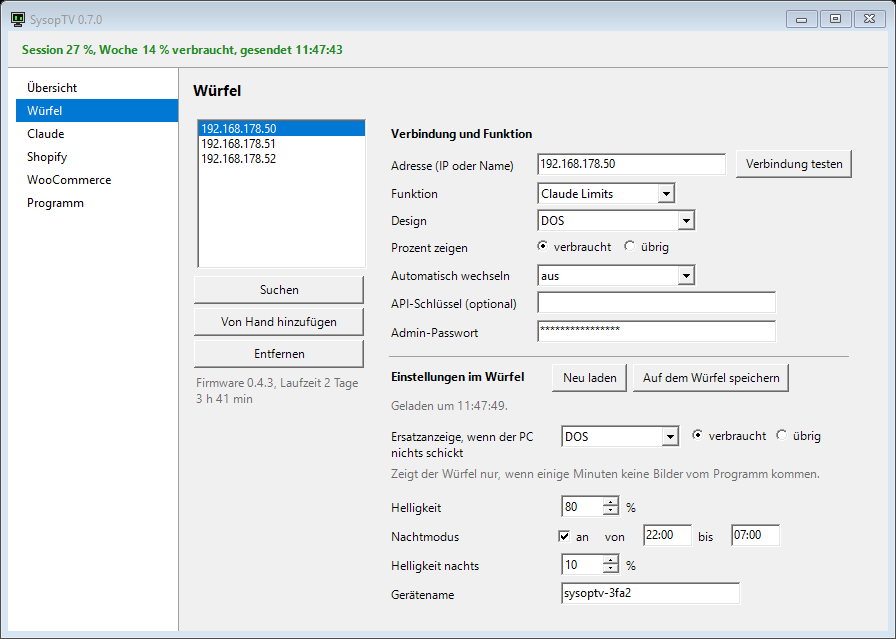
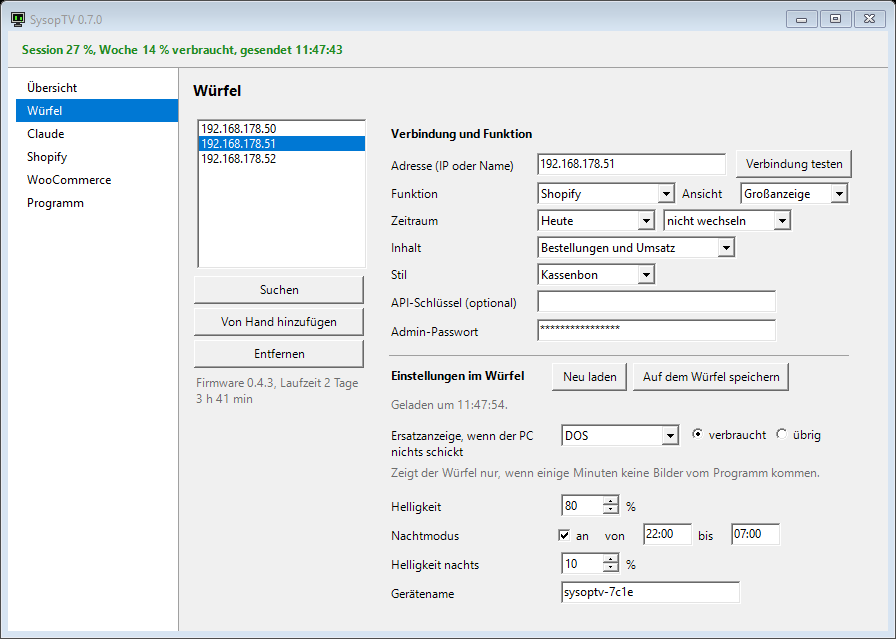
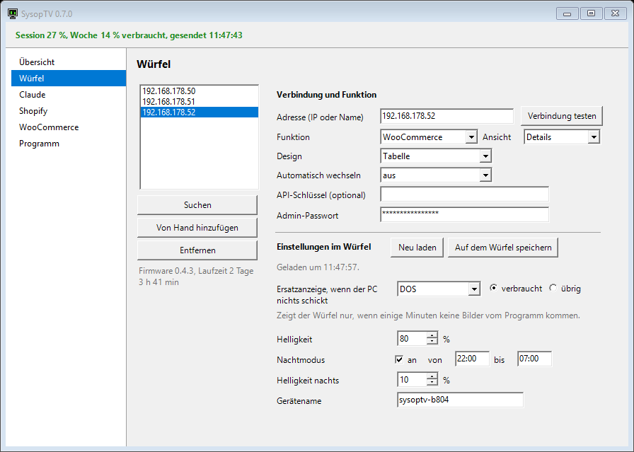
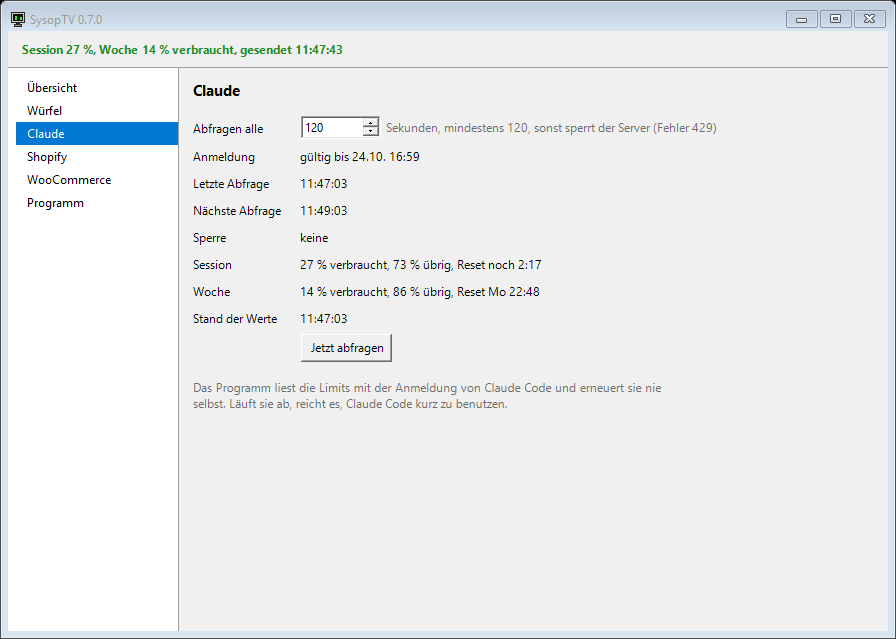
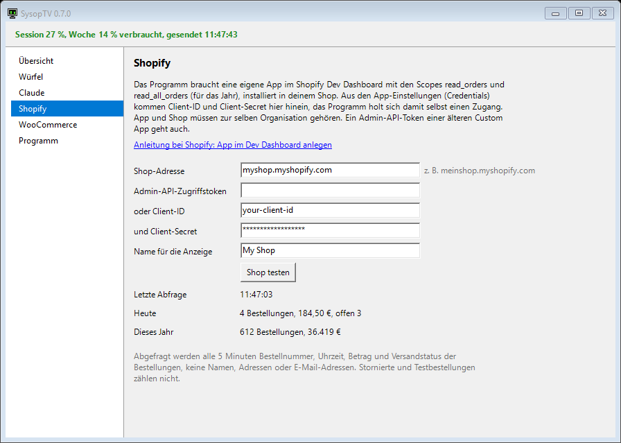
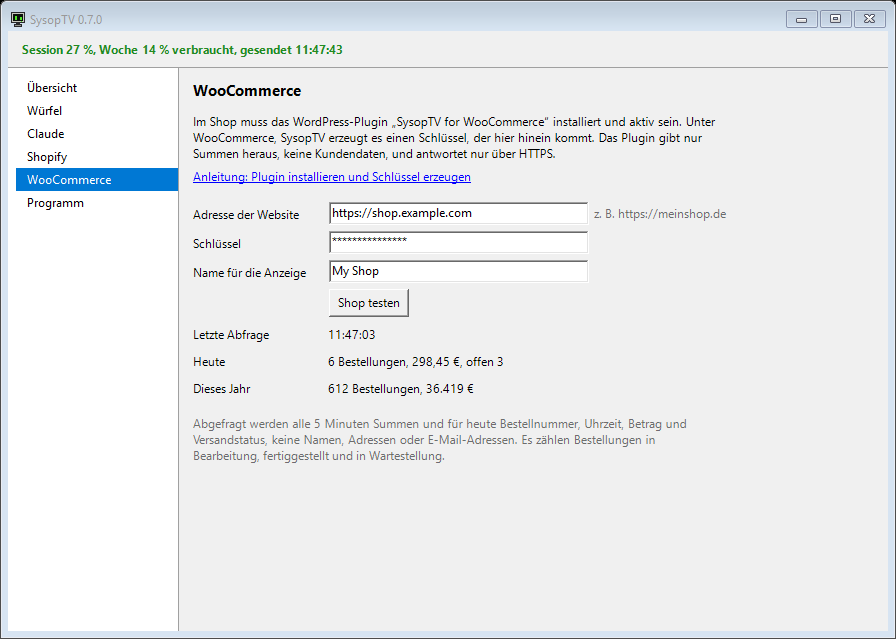
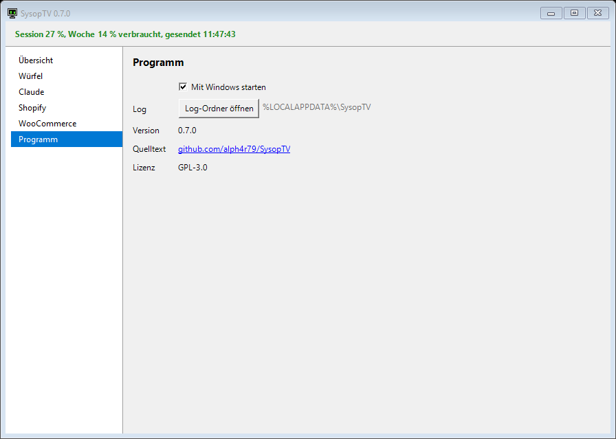

# Windows app

At the end of this guide the SysopTV program runs on your PC, starts with Windows and feeds one or more cubes with Claude limits or shop numbers.

You need:

- Windows 10 or 11 with .NET Framework 4.8 (part of Windows 10 from version 1903 and of Windows 11)
- a cube with SysopTV in the same network, see [Installation](installation.md)
- for Claude Limits: Claude Code installed and logged in with a Claude subscription, see [Claude limits](claude.md)
- for the shop displays: the access to your shop, see [Shopify](shopify-setup.md) or [WooCommerce](woocommerce-setup.md)

## 1. Download and install

Download one of these files from the [GitHub Releases](https://github.com/alph4r79/SysopTV/releases):

- `sysoptv-app-<version>-setup.exe`: the setup
- `sysoptv-app-<version>-portable.zip`: the same program without setup

**Setup.** Start the file. It installs without administrator rights to `%LOCALAPPDATA%\Programs\SysopTV` and adds an entry to the start menu. Leave "Mit Windows starten" (start with Windows) ticked, so the program runs after every login. At the end "SysopTV jetzt starten" (start SysopTV now) starts it.

**Portable.** Unpack the ZIP anywhere and start `SysopTV.exe`. To start it with Windows, tick "Mit Windows starten" on the page "Programm" of its window.

**Windows warns about an unknown publisher.** The program is not signed, because a code signing certificate costs money every year. On the first start Windows SmartScreen may show "Der Computer wurde durch Windows geschützt" with "Unbekannter Herausgeber" (unknown publisher). Click "Weitere Informationen" (more info), then "Trotzdem ausführen" (run anyway). The source code is open in this repository, and you can build the program yourself, see [Developers](developers.md#windows-program).

**Uninstall** in the Windows settings like any other program. It removes the program, the start menu entry and the start with Windows. It asks whether your settings and the log should be deleted as well; the answer "Nein" (no) is preselected.

## 2. First start

The program runs in the notification area of the taskbar, next to the clock. A double-click on its icon opens the window. A right-click opens the menu: current state, "Jetzt senden" (send now), "Würfel im Browser öffnen" (open the cube in the browser), "Fenster öffnen" (open window), "Log öffnen" (open log), "Beenden" (exit).

The colour of the icon shows the state:

- green: data is being sent
- amber: less than 20 % left, or the login of Claude Code has expired
- red: no data from Anthropic, or a cube is not reachable
- grey: no data yet

If the program finds the old PowerShell sender `sysoptv-sender.ps1` in the startup folder or running, it offers once per start to move its shortcut to `%APPDATA%\SysopTV\alt\` ("Verknüpfung entfernen", remove shortcut). Two senders would ask for the limits twice. A running script is not stopped: end it in the Task Manager (powershell.exe) or restart the PC.

At the top the window shows the state and the time of the last sending. On the left is a menu with the pages described below. Settings of the program are saved as soon as you leave a field, there is no save button. Only the settings stored in the cube need "Auf dem Würfel speichern".

## Übersicht (overview)



One line per cube with address, function, design, time of the last sending and state in colour. Below it the Claude values and the shop values of today, of the year and the time they were read.

## Würfel (cubes)

On the left the list of your cubes:

- "Suchen" (search) looks for cubes in your local network, first at `sysoptv.local`, then at all addresses of your network. Click a result to add it.
- "Von Hand hinzufügen" (add by hand) adds an empty entry, then type the address.
- "Entfernen" (remove) takes the selected cube out of the list.

On the right the selected cube in two parts.

### Verbindung und Funktion (connection and function)



- **Adresse** (address): IP address or name of the cube, for example `192.168.178.50`. "Verbindung testen" (test connection) shows the firmware version and the uptime below the list.
- **Funktion** (function): what the cube shows.
  - **Claude Limits**: your 5 hour session and your weekly limit, see [Claude limits](claude.md).
  - **Shopify**: orders and revenue of your Shopify shop.
  - **WooCommerce**: orders and revenue of your WooCommerce shop.
- **API-Schlüssel (optional)** (API key): only if you set a key in the cube, see [Privacy and security](privacy-security.md#api-key-of-the-cube).
- **Admin-Passwort**: the admin password of the cube. It is needed for the settings in the cube.

For **Claude Limits**:

- **Design**: one of ten designs, see [Designs](designs.md#claude-limits). The program draws the picture itself and sends it to the cube.
- **Prozent zeigen** (show percent): "verbraucht" (used) or "übrig" (remaining).
- **Automatisch wechseln** (change automatically): off, every 30 or every 60 seconds through all designs, starting with the chosen one.
- **Klapp-Animation** (flip animation): appears for the design Fallblatt and with the automatic change. The changing cards flip over in three small steps.

A cube with firmware older than 0.4.0 has no picture mode. The program then sends only the numbers, and the cube shows them in its own design. The list then offers only the six designs of the firmware, and the page says "Firmware zu alt für alle Designs. Bitte die Firmware aktualisieren." (firmware too old for all designs, please update the firmware). Shopify and WooCommerce need firmware 0.4.0 or newer.

For **Shopify** and **WooCommerce** choose the **Ansicht** (view) next to the function:



**Großanzeige** (big display) shows one period with one big number:

- **Zeitraum** (period): Heute (today), Diese Woche (this week, since Monday 0:00), Dieser Monat (this month, since the 1st) or Dieses Jahr (this year, since 1 January), in the time zone of the shop. Next to it the change of the period: "nicht wechseln" (no change), every 30 or every 60 seconds through all four.
- **Inhalt** (content): "Bestellungen und Umsatz" (orders and revenue), "nur Bestellungen" (only orders) or "nur Umsatz" (only revenue).
- **Stil** (style): Kassenbon, DOS, Bernstein, LED-Matrix, Hell, Fallblatt or 4-Ton-Grün, see [Designs](designs.md#shop-big-display).



**Details** shows one of four detail views: Tabelle, Bestellliste, Kassenbon Übersicht or Wochendiagramm, see [Designs](designs.md#shop-details). "Automatisch wechseln" changes through the four.

If the access to the shop is not set up yet, a short hint below the function links to the page Shopify or WooCommerce. The cube then shows "Shop nicht eingetragen" (shop not set up).

When you change the function or the view, the cube gets a full picture of the new one at once. Fields that do not count for the chosen function are hidden.

### Einstellungen im Würfel (settings in the cube)

These settings are stored in the cube itself.

- They need the admin password of the cube in the field above.
- With the password they are loaded on their own when the window opens, when you choose a cube and when you open the page. "Neu laden" (load again) loads them once more.
- "Auf dem Würfel speichern" (save on the cube) stays locked until the values were loaded. After saving, the program reads them back.

The fields:

- **Ersatzanzeige, wenn der PC nichts schickt** (fall back display when the PC sends nothing): the design of the cube itself, with "verbraucht" or "übrig". The cube shows it only when no pictures come from the program for a few minutes, for example when the PC is off. A cube with Claude Limits and firmware 0.4.2 or newer then shows the last numbers there, otherwise the clock and NO CARRIER.
- **Helligkeit** (brightness): 10 to 100 %.
- **Nachtmodus** (night mode): from and to as time, and **Helligkeit nachts** (brightness at night) from 0 to 100 %. 0 switches the display off.
- **Gerätename** (device name), see [Installation](installation.md#device-name).

A cube with firmware older than 0.4.0 has no interface for these settings. The page then shows the button "Einstellungen am Würfel öffnen" (open the settings of the cube), which opens the web interface of the cube.

### Several cubes

Every cube in the list gets its own function, design and view. Several cubes side by side work, for example one with Claude Limits and one with your shop. The limits are fetched from Anthropic only once per round, no matter how many cubes show them, and each shop is asked once every 5 minutes.

The pictures are drawn every second but only sent when something changes, and then only the changed parts of the screen. After a restart of the cube and at least every 10 minutes the whole picture goes out. While the program runs, it sends a sign of life at least every 60 seconds, so the cube never switches to its fall back display.

As long as there are no values at all, the cube still gets a picture: a short notice in the colours of the chosen design, for example "Claude-Daten werden geladen", "Shopdaten werden geladen", "Zu viele Anfragen" or "Shop nicht erreichbar" with the time of the next try. Values that are not fresh stay on the screen with a small "Stand HH:MM" (as of).

## Claude



The interval in seconds (at least 120), the state of the login, the time of the last and the next query, an active pause after error 429, the values of session and week, and "Jetzt abfragen" (query now, at most once in 120 seconds). Details in [Claude limits](claude.md).

## Shopify



Shop address, the access (client ID and client secret of your app, or the token of an older custom app), the name for the display and "Shop testen" (test the shop). Below the last query, today and this year. Details in [Shopify](shopify-setup.md).

## WooCommerce



Address of the website, the key of the plugin, the name for the display and "Shop testen". Details in [WooCommerce](woocommerce-setup.md).

## Programm (program)



- **Mit Windows starten** (start with Windows): the program starts after every login.
- **Log-Ordner öffnen** (open log folder): the folder with `app.log`.
- version, source code and licence

## Where the program keeps its files

- `%APPDATA%\SysopTV\config.json`: your cubes and settings. API keys, admin passwords, the Shopify access and the WooCommerce key are stored only encrypted for your Windows user.
- `%LOCALAPPDATA%\SysopTV\state.json`: time of the last query, a pause after error 429 and the last valid values, so a restart neither asks too early nor shows nothing. Never the login of Claude Code.
- `%LOCALAPPDATA%\SysopTV\app.log`: the log, at most 1 MB, then one backup `app.old.log`.

More in [Privacy and security](privacy-security.md).

**For advanced users:** the option `--data-dir <folder>` or the environment variable `SYSOPTV_DATA_DIR` puts `config.json`, `state.json` and `app.log` into that folder instead. This is meant for trials and tests that must not touch your real settings.

## Command line

- `SysopTV.exe --once` queries the limits once, sends the numbers to the first cube with Claude Limits and prints the result. It keeps to the 120 seconds after the last query and updates `state.json`. It does not run while the program is running.
- `--device 192.168.178.50` sends to another address for this one run.
- `SysopTV.exe --preview <folder>` writes every picture design with sample data as PNG files, without network.

## Settings of older versions

Settings of all earlier versions are taken over automatically, nothing is lost:

- A cube that drew Claude itself ("Claude, Würfel zeichnet selbst" up to 0.6.0) becomes Claude Limits. It gets the design, "verbraucht" or "übrig" and the automatic change the cube showed, as soon as the program reaches it. Until then, and with firmware before 0.3.1, it shows DOS.
- "Claude als Bild" becomes Claude Limits with the same design.
- "Shop als Bild" becomes Shopify or WooCommerce after its source, with all settings of the view.

## Alternative: the PowerShell script

Instead of the program you can use the older and smaller sender `sender/sysoptv-sender.ps1`. It only sends the Claude numbers, so the cube shows them in its own design. Use either the program or the script, never both: two senders would ask for the limits twice.

1. Copy the folder `sender` to your PC, for example to `C:\Path\to\sender\`.
2. Open PowerShell (the line starts with `PS`) and run a single test with the address of your cube:

   ```powershell
   cd C:\Path\to\sender
   powershell -ExecutionPolicy Bypass -File .\sysoptv-sender.ps1 -DeviceIp 192.168.178.50 -Once
   ```

   The window shows what was read and sent, and whether the cube accepted it.
3. To start it automatically, press Win+R, type `shell:startup` and press Enter. In the startup folder create a new shortcut with this target, with your own path and address:

   ```
   C:\Windows\System32\WindowsPowerShell\v1.0\powershell.exe -WindowStyle Hidden -ExecutionPolicy Bypass -File "C:\Path\to\sender\sysoptv-sender.ps1" -DeviceIp 192.168.178.50
   ```

| Parameter | Default | Meaning |
|---|---|---|
| `-DeviceIp` | `sysoptv.local` | Address of the cube. Give the IP address or the device name `sysoptv-xxxx.local`. |
| `-IntervalSeconds` | `120` | Seconds between two queries. Smaller values are raised to 120. |
| `-ApiKey` | empty | Only needed if an API key is set in the cube. |
| `-Once` | off | One single run with output in the window, for testing. |

The script writes a log to `%LOCALAPPDATA%\SysopTV\sender.log` (at 200 KB renamed to `sender.log.old`). If another sender already runs on the PC, it stops.
